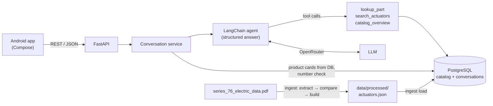

# Series 76 Technical Assistant

A technical assistant for plant engineers who select **Series 76 electric actuators**. Ask about a
part number, describe your requirements, or compare models; the assistant answers in a native
Android app with product cards whose every number comes from the manufacturer's tables.

- **Backend:** Python 3.12, FastAPI, a LangChain agent with three custom tools over PostgreSQL.
- **Data:** `series_76_electric_data.pdf` → verified JSON → PostgreSQL (68 parts, 111 ratings).
- **App:** Kotlin + Jetpack Compose (Conversations, Chat and a developer-only Debug screen).
- **Quality:** 186 backend tests and CI, plus 44 LLM eval cases (34 from the requirements, 10 robustness cases); 43/44 on the final run.

Total OpenRouter spend for the whole project (extraction, development, evals): about **USD 0.15** of
the USD 10 key.

---

## Contents

1. [Architecture](#1-architecture)
2. [Setup](#2-setup)
3. [Backend with Docker](#3-backend-with-docker)
4. [Ingestion](#4-ingestion)
5. [Android app](#5-android-app)
6. [Design and trade-offs](#6-design-and-trade-offs)
7. [Model choices](#7-model-choices)
8. [Testing and evals](#8-testing-and-evals)
9. [Optional features](#9-optional-features)
10. [Troubleshooting](#10-troubleshooting)
11. [Repository layout](#11-repository-layout)

---

## 1. Architecture



One chat turn: the app sends `{session_id?, query}` → the agent reads the conversation history and
calls the tools (fixed, parameterized queries; no text-to-SQL) → it must finish with a **structured
answer** that names products **by part number only** → the backend builds the product cards from
the database, checks every number in the answer text against the tool results, saves the turn and
returns it. The LLM never produces a spec value the user sees.

Full design log with every decision and its trade-off: [`docs/design.md`](docs/design.md).
Requirements and acceptance criteria: [`docs/requirements.md`](docs/requirements.md).

---

## 2. Setup

### Requirements

| Tool | Version | Needed for |
|---|---|---|
| Docker Desktop (with Compose) | recent | backend + database (`docker compose up`) |
| Android Studio | Rabbit (2026) or newer, Android SDK 37 | the app |
| An OpenRouter API key | | the agent's LLM calls |
| Python 3.12 + [uv](https://docs.astral.sh/uv/) | uv 0.13+ | only to run tests, evals or ingestion outside Docker |

### Environment variables

```bash
cp .env.example .env            # Windows PowerShell: Copy-Item .env.example .env
```

Then edit `.env`. Only one value is required:

| Variable | Required | Default | What it does |
|---|---|---|---|
| `OPENROUTER_API_KEY` | **yes** | | Key for the agent's LLM calls |
| `LLM_MODEL` | no | `anthropic/claude-haiku-5.5` | Agent model (any OpenRouter model with tool calling) |
| `LLM_TEMPERATURE`, `LLM_MAX_TOKENS`, `LLM_TIMEOUT_S`, `MAX_TOOL_ITERATIONS` | no | `0`, `1024`, `30`, `6` | Agent limits |
| `LLM_PRICE_INPUT_PER_M`, `LLM_PRICE_OUTPUT_PER_M` | no | `0.10`, `0.50` | Only for the estimated cost shown in logs and the debug screen |
| `API_PORT` | no | `8000` | Host port of the API |
| `POSTGRES_PORT` | no | `5433` | Host port of PostgreSQL (5433 avoids a locally installed PostgreSQL) |
| `POSTGRES_USER`, `POSTGRES_PASSWORD`, `POSTGRES_DB` | no | `series76` | Database credentials (local only) |
| `DEBUG_ENDPOINTS` | no | `true` | Serves `/api/messages/{id}/debug` for the app's debug screen; set `false` in production |
| `AUTH_TOKEN_TTL_HOURS` | no | `168` | Lifetime of a login token (7 days) |
| `WHISPER_MODEL` | no | `small` | Speech-to-text model for voice messages (`tiny`, `base`, `small`, `medium`); built into the image, so rebuild after changing it |
| `HISTORY_WINDOW`, `LOG_LEVEL` | no | `12`, `INFO` | Messages sent to the LLM as context; log level |
| `LANGFUSE_PUBLIC_KEY`, `LANGFUSE_SECRET_KEY`, `LANGFUSE_HOST` | no | empty | Optional tracing to Langfuse Cloud ([§9](#9-optional-features)) |
| `EXTRACTION_A_*`, `EXTRACTION_B_*` | no | | Only to re-run the PDF extraction ([§4](#4-ingestion)) |
| `DATABASE_URL` | no | localhost:5433 | Only for running the backend outside Docker |

`.env` is git-ignored and never copied into the Docker image (`.dockerignore`); Compose passes only
the variables listed in `docker-compose.yml` to the container at runtime.

---

## 3. Backend with Docker

From the repository root:

```bash
docker compose up --build
```

This starts PostgreSQL and the backend. On every start the backend **creates or migrates the schema**
(`alembic upgrade head`), **loads the verified catalog** (`python -m ingest load`, idempotent; saved
conversations are kept), **creates the test users** (`python -m app.auth.seed`, [§9](#9-optional-features))
and serves the API. Ready when the log shows `Uvicorn running`.

The first build also downloads the open-source speech-to-text model for voice messages (~480 MB,
[§9](#9-optional-features)) into the image, so it takes a few minutes and the image is about 2 GB.

| URL | What |
|---|---|
| http://localhost:8000/docs | Interactive API docs (Swagger): try every endpoint from the browser |
| http://localhost:8000/health/ready | Readiness (database reachable) |

Quick check: sign in as a test user, then ask with the token (every `/api/*` route needs it). In
Swagger, call `POST /api/auth/login`, then paste the token into **Authorize**.

```bash
TOKEN=$(curl -s -X POST http://localhost:8000/api/auth/login -H "Content-Type: application/json" \
  -d '{"email": "alice@series76.test", "password": "Damper-1751-torque"}' | python -c "import json,sys; print(json.load(sys.stdin)['token'])")
curl -X POST http://localhost:8000/api/conversation -H "Content-Type: application/json" \
  -H "Authorization: Bearer $TOKEN" -d '{"query": "What is the torque of 763B00-11300000/A?"}'
```

Send the returned `session_id` with the next question to continue the conversation
(`"and how much power does it draw?"`). Conversations are stored in PostgreSQL and survive restarts.

### Endpoints

| Method and path | Purpose |
|---|---|
| `POST /api/auth/login` | `{email, password}` → `{token, token_type, expires_at, user}`. Open; every other `/api/*` route needs `Authorization: Bearer <token>` |
| `POST /api/auth/logout` | Revokes the token sent with the request (204) |
| `GET /api/auth/me` | The signed-in user (the app checks a saved token with it) |
| `POST /api/conversation` | `{session_id?, query}` → `{session_id, message_id, answer, status, view, products, alternatives, quick_replies, created_at}` |
| `POST /api/transcribe` | Voice message: multipart field `audio` (M4A/AAC, WAV, MP3 or OGG, max 60 s / 5 MB) → `{text, language, duration_s}`. The audio is not stored |
| `GET /api/sessions` | The user's conversations: `id`, `title`, `created_at`, `updated_at`, `message_count` |
| `GET /api/sessions/{id}/messages` | Full history to resume a conversation, with the product cards as they were shown |
| `GET /api/messages/{id}/debug` | **Developer only:** tool calls with arguments, raw results and durations, model, tokens, cost, number check |
| `GET /health`, `GET /health/ready` | Liveness and readiness probes |

Changes from the suggested endpoints: they are kept as suggested, with `message_count` added to
`/api/sessions`, `logout` and `me` added to login, and `transcribe` added for voice messages. The debug data is **not** in the chat
response (so end users never receive tool names or internals); it has its own endpoint, enabled by
`DEBUG_ENDPOINTS`. Each user only reaches their own conversations; another user's conversation or
message answers 404, as if it did not exist.

`status` is one of `answered`, `clarification_needed`, `not_found`, `no_data`, `no_match`,
`out_of_scope`; `view` is `cards`, `comparison` or `none`. Errors always have the shape
`{"error": {"code": "...", "message": "..."}}` (e.g. `unauthorized` / `invalid_credentials` 401,
`not_found` 404, `invalid_request` 422, `audio_empty` / `audio_invalid` 400, `audio_too_large` 413,
`no_speech` 422, `transcription_unavailable` 503,
`llm_unavailable` / `llm_budget_exhausted` 502, `llm_not_configured` / `database_unavailable` 503).

### Without Docker (development)

```bash
docker compose --env-file .env.example up -d db     # only the database
cd backend
uv sync
uv run alembic upgrade head
uv run python -m ingest load
uv run python -m app.auth.seed                       # test users (§9)
uv run uvicorn app.main:app --reload --port 8000
```

---

## 4. Ingestion

The tables in `series_76_electric_data.pdf` are **images**, so text-based PDF parsers return nothing.
The pipeline (`backend/ingest/`, run as `python -m ingest <step>` from `backend/`):

| Step | Command | Output | Needs a key |
|---|---|---|---|
| 1. Extract | `uv run python -m ingest extract` | `data/interim/extractions/` (git-ignored) | yes (two vision models) |
| 2. Compare | `uv run python -m ingest compare` | `data/interim/comparison.md`: every cell where the two models disagree | no |
| 3. Build | `uv run python -m ingest build` | **`data/processed/actuators.json`**: human resolutions applied, validation rules passed | no |
| 4. Load | `uv run python -m ingest load` | PostgreSQL tables `catalog_tables`, `parts`, `ratings` | no |

- **Two independent vision models** (Gemini on Google AI Studio's free tier and Claude Haiku via
  OpenRouter) transcribe every table; step 2 diffs them cell by cell, so a human only reviews the
  cells where they disagree. In our run 912 of 917 cells agreed; the 5 conflicts were resolved by
  hand against the PDF and recorded in [`data/review/resolutions.yaml`](data/review/resolutions.yaml).
- Table-level facts that are not in the cells (enclosure, supply, certifications, hazardous
  markings, footnotes) come from [`data/table_metadata.yaml`](data/table_metadata.yaml), written by hand
  from the PDF.
- **The processed data is committed** (`data/processed/actuators.json`), so nobody needs to re-run
  extraction: Docker runs only step 4. Re-running steps 1 to 3 needs `EXTRACTION_A_*` (free Google AI
  Studio key) and `OPENROUTER_API_KEY`; it costs about USD 0.01.

---

## 5. Android app

### Build and run

1. Start the backend (`docker compose up --build`).
2. Open the **`mobile/`** folder in Android Studio and let Gradle sync.
3. Create an emulator if you have none: **Device Manager → + → Pixel → system image API 37**.
4. Select the `app` configuration and press **Run ▶**.

### Point the app to the backend

The backend URL is a build setting, read from `mobile/local.properties` (not committed):

```properties
api.baseUrl=http://10.0.2.2:8000/
```

| Where the app runs | `api.baseUrl` |
|---|---|
| Android emulator, backend on the same computer | `http://10.0.2.2:<API_PORT>/` (default `http://10.0.2.2:8000/` if the line is absent) |
| Physical phone on the same Wi-Fi | `http://<your computer's LAN IP>:<API_PORT>/` (allow the port in the computer's firewall) |

Press **Run** again after changing it (it is compiled into `BuildConfig`).

**Android 17 (API 37) asks for a "nearby devices" permission on first launch. Tap Allow.** Android 17
blocks apps from connecting to local-network addresses such as `10.0.2.2` unless they hold
`ACCESS_LOCAL_NETWORK`; without it every request times out. Only the debug build declares and
requests it (design A9).

### Screens

- **Login:** email and password of a test user ([§9](#9-optional-features)). The app remembers the
  session across restarts; when the token expires or is revoked it returns here with "Your session
  expired". **Log out** is in the account menu (top right of Conversations).
- **Conversations:** saved conversations, newest first; pull to refresh; **New conversation**.
- **Chat:** answer text plus **product cards** (part number, enclosure, power supply, specs grouped by
  service with units and 60/50 Hz conditions, certifications). 2+ products can be compared **side by
  side**. "No match" answers show labelled **closest alternatives**; clarifications show tappable
  **quick replies**. Typing indicator while the agent works; a failed message stays on screen with
  **Retry**. With the message box empty, the **microphone** button records a voice message
  ([§9](#9-optional-features)).

**Voice on the emulator:** the emulator uses your computer's microphone only if you allow it:
**Extended controls (⋯) → Microphone → "Virtual microphone uses host audio input"** (turn it on
again after restarting the emulator). The app asks for the microphone permission the first time you
tap the button.

### Open the debug screen

**Long-press any assistant answer → "Developer details".** It shows the model, latency, tokens,
estimated cost, the number-check result, the conversation context sent to the model, and every tool
call with its arguments, raw result and duration.

The screen exists **only in the debug build** (source set `app/src/debug`); a release build contains
neither the screen nor the menu entry, so end users cannot reach it. The backend serves its data
only while `DEBUG_ENDPOINTS=true`.

---

## 6. Design and trade-offs

Every decision below has an ID and a full entry in [`docs/design.md`](docs/design.md) (with the
alternatives considered); known limitations are listed in its §9.

**Data**
- **Structured tables, not RAG.** The catalog is a set of numeric tables, so it lives in PostgreSQL as
  rows (`parts`, `ratings`) and is queried exactly. No embeddings or pgvector: semantic search over 68
  parts adds nothing and cannot guarantee exact numbers. *Trade-off:* questions outside the tables
  (prices, dimensions) are answered as "not in the data" instead of guessed.
- **Dual-model extraction with human review** (A1). *Trade-off:* a person must resolve conflicts, but
  only for the few cells where two independent models disagree.
- **Interpretation is labelled as such.** Hazardous-location markings are copied word for word;
  their meaning (zones, gas groups) follows NEC/IEC conventions and the answer says so. Anything not
  covered by a marking (Zone 0, hydrogen/IIC, dust) is "not listed", never "yes" (D-2).

**Agent and numbers**
- **Three fixed tools** (`lookup_part`, `search_actuators`, `catalog_overview`), thin wrappers over
  parameterized queries; requirements are named predicates evaluated in Python. No text-to-SQL.
- **The LLM never writes a spec value the user sees** (B3): it returns part numbers; the backend
  builds the cards from the database. A **number check** (B4) compares every number in the answer
  text with that turn's tool results; on a mismatch the agent gets one repair attempt, then a safe
  fallback sentence. Part numbers that no tool returned are dropped.
- **Deterministic safety rules over prompting:** hazardous requirements are never relaxed when
  suggesting alternatives; a "no match" can never show a product as a match (B10a); a request without
  a power supply asks for it, offering only supplies that have matches (B2a). Each rule was found or
  confirmed by the eval set.
- *Trade-off:* the number check can only verify numbers that appear in tool results, so the agent
  is told to repeat values rather than compute them.

**Conversations and API**
- History is stored per session in PostgreSQL; each turn sends the last 12 messages plus a short
  context note of recently shown products, so "and how much power does it draw?" resolves "it". A
  failed turn is rolled back (no empty conversations).
- No streaming: one request per turn (~2.5 s median) with a typing indicator. *Trade-off:* simpler
  on both sides and compatible with the post-answer number check.

**App**
- **Server-driven specs:** labels, units, grouping and order come from the API, so the app renders
  any product (and the comparison table) generically.
- MVVM with `StateFlow`, Hilt, Retrofit + kotlinx.serialization, Navigation Compose; no local
  database (the backend is the source of truth). Numbers are formatted like the datasheet
  ("4,400") with tabular figures.

---

## 7. Model choices

All models are configurable through environment variables.

| Role | Model | Price (USD per 1M tokens in / out) | Why |
|---|---|---|---|
| Chat agent (`LLM_MODEL`) | `anthropic/claude-haiku-5.5` via OpenRouter | 0.10 / 0.50 | Reliable tool calling and structured output at a low price. Passes 34/34 eval cases; about **USD 0.0012 per turn**, median latency 2.5 s. |
| Extraction model A (`EXTRACTION_A_*`) | `gemini-3.5-flash` via Google AI Studio (free tier) | free | Vision model from a different family than B, so their mistakes are independent (the assessment's hint for free experimenting). |
| Extraction model B (`EXTRACTION_B_*`) | `anthropic/claude-haiku-5.5` via OpenRouter | 0.10 / 0.50 | Second independent transcription; the whole extraction cost USD 0.012. |

- Compared on the full eval set (34 cases, same code and prompt, one run each; details in
  [`docs/evals.md`](docs/evals.md#model-comparison)):
  - `anthropic/claude-haiku-5.5`: 34/34, USD 0.049, 2.5 s median. **Shipped.**
  - `openai/gpt-6-luna`: 33/34, USD 0.027, 2.7 s median. Viable cheaper fallback; its one miss was
    a missing product card on a follow-up.
  - `openai/gpt-oss-120b`: 12/34. In 22 cases it never returned the structured final answer the
    agent requires.
- **Budget:** unit tests never call an LLM (a scripted fake model drives the real agent loop); evals
  run by hand with a cost guard (`--max-cost`, default USD 1); every turn logs its tokens and
  estimated cost.

---

## 8. Testing and evals

**Backend** (needs the database: `docker compose --env-file .env.example up -d db`):

```bash
cd backend
uv sync
uv run pytest                                        # 186 tests, no LLM calls, own database series76_test
uv run ruff check . && uv run ruff format --check .
```

CI (`.github/workflows/backend-ci.yml`) runs lint, format check and the tests against a PostgreSQL
service, and builds the Docker image.

**LLM evals** (real model, costs about USD 0.05 per run; reads `OPENROUTER_API_KEY` from `.env`):

```bash
cd backend
uv run python -m evals.run                           # all 44 cases on LLM_MODEL
uv run python -m evals.run --case lookup-basic       # one case
uv run python -m evals.run --model openai/gpt-oss-120b
```

44 cases (51 turns) tied to the acceptance criteria, graded by deterministic checks (status, expected
and excluded part numbers, product fields, quick replies, answer language, no internals, no invented
numbers or part numbers). Final run: 43/44 cases, USD 0.067 (the one miss was a correct answer graded too strictly; the
check was relaxed). Results: [`docs/evals.md`](docs/evals.md); raw runs in
`backend/evals/results/`.

**App:**

```bash
cd mobile
./gradlew testDebugUnitTest lintDebug                # 12 tests; Windows: gradlew.bat
```

---

## 9. Optional features

| Feature | Status |
|---|---|
| Login (US-21) | **Implemented** (backend and app). Email and password return an opaque token (7 days, `AUTH_TOKEN_TTL_HOURS`); the database stores only its SHA-256 hash, so logout revokes it at once. Passwords are stored as argon2id hashes. Every `/api/*` route except login needs `Authorization: Bearer <token>`, and each user sees only their own conversations. The app keeps the token in DataStore (excluded from backup) and goes back to the login screen on any 401. Design U1–U7. |
| Langfuse tracing (extra) | **Implemented, off by default.** Set `LANGFUSE_PUBLIC_KEY` and `LANGFUSE_SECRET_KEY` (and `LANGFUSE_HOST` for the US region) to trace every turn (LLM calls, tool calls, tokens, latency) to Langfuse Cloud, grouped by conversation and tagged `api` or `eval`. Tracing errors never affect an answer. |
| Voice messages (US-22) | **Implemented.** How it works: below the test users. |

**Test users** (created on every start from `backend/app/auth/seed_users.json`, which holds only
the hashes). These are test credentials for this demo, not secrets:

| Email | Password |
|---|---|
| `alice@series76.test` | `Damper-1751-torque` |
| `bob@series76.test` | `Torque-7981-gear` |

Not implemented (not required by the assessment): sign-up, password reset, refresh tokens, login rate
limiting.

**Voice messages: how they work** (design O2 and V1–V7)

1. In the chat, with the message box empty, tap the **microphone**. The app records AAC audio (mono,
   16 kHz) with a timer; it stops by itself at 60 s. Tap ✓ to finish or ✕ to discard.
2. The app uploads the recording to `POST /api/transcribe`. The backend transcribes it with
   **faster-whisper** (open-source Whisper, `small` model, on the CPU). No API key and no OpenRouter
   cost. A vocabulary hint helps it write part numbers the catalog's way (`763B00-11300000/A`).
3. The text appears **in the message box**, not sent: check it (part numbers especially), edit if
   needed, and tap Send. From there it is a normal chat message.

Decisions and trade-offs:
- **On the backend, not the phone:** same quality on every device and no native code in the app.
  Cost: a larger image (~2 GB; the model is built in, so nothing is downloaded at runtime) and about
  4–5 s to transcribe an 8 s question on a laptop CPU.
- **Review before sending:** speech recognition is weakest on part numbers; one extra tap avoids
  asking the wrong question.
- **Privacy:** the audio is decoded in memory and discarded, on the server and on the phone; the logs
  record only its length, language and processing time, never the words.
- English and Spanish are detected automatically. Errors (no permission, silence, too long, server
  unreachable) are shown above the message box, and typing keeps working.

---

## 10. Troubleshooting

| Problem | Fix |
|---|---|
| Port 8000 (or 5433) already in use | Set `API_PORT` (or `POSTGRES_PORT`) in `.env`, run `docker compose up -d`, and update `api.baseUrl` in `mobile/local.properties`. |
| App shows "The server took too long to answer" | Tap **Allow** on the Android 17 "nearby devices" prompt (or enable it in the app's settings → Permissions); check the backend is running and `api.baseUrl` uses the right port. |
| App goes back to the login screen with "Your session expired" | The token expired (7 days), was revoked by a logout, or the database was reset. Sign in again. |
| Voice: "No speech was recognized" on the emulator | Turn on **Extended controls → Microphone → Virtual microphone uses host audio input** and check the computer's microphone. |
| App shows "Can't reach the server" | Backend not running, wrong `api.baseUrl`, or (physical phone) the computer's firewall blocks the port. |
| Chat answers `llm_not_configured` (503) | `OPENROUTER_API_KEY` is empty in `.env`; set it and restart: `docker compose up -d`. |
| Chat answers `llm_budget_exhausted` (502) | The OpenRouter key has no credit left. |
| Android Studio shows red errors in `build.gradle.kts` | **File → Sync Project with Gradle Files**. |

---

## 11. Repository layout

```
backend/                 FastAPI + LangChain agent (Python 3.12, uv)
  app/api/               routes, request/response schemas, error handlers
  app/services/          catalog queries, conversation flow, product cards
  app/tools/             LangChain tools (thin wrappers over the catalog service)
  app/agent/             agent runner, system prompt, structured answer, number check
  app/db/                SQLAlchemy models and session; alembic/ holds the migrations
  ingest/                PDF → JSON → PostgreSQL pipeline
  evals/                 eval cases, runner, results
  tests/                 pytest suite
  Dockerfile
mobile/                  Android app (Kotlin, Jetpack Compose)
  app/src/main/          data layer, screens, theme
  app/src/debug/         developer-only debug screen and local-network settings
data/
  raw/                   source PDFs
  table_metadata.yaml    hand-written table facts (enclosure, supply, certifications, markings)
  review/                human resolutions of extraction conflicts
  processed/             verified dataset loaded into PostgreSQL
docs/
  requirements.md        user stories, acceptance criteria, data decisions D-1…D-6
  design.md              every design decision with its trade-off, known limitations
  evals.md               eval results
  design/theme/          Material Theme Builder export (seed #C25E00)
.claude/                 Claude Code configuration used to build this project (CLAUDE.md)
docker-compose.yml       database + backend
.env.example             all configuration, with placeholders
```

The project was built with Claude Code. `.claude/CLAUDE.md` holds the project rules it worked under
(numbers only from the database, never read `.env`, record every decision in `docs/design.md`, ask
before changing an approved decision).
